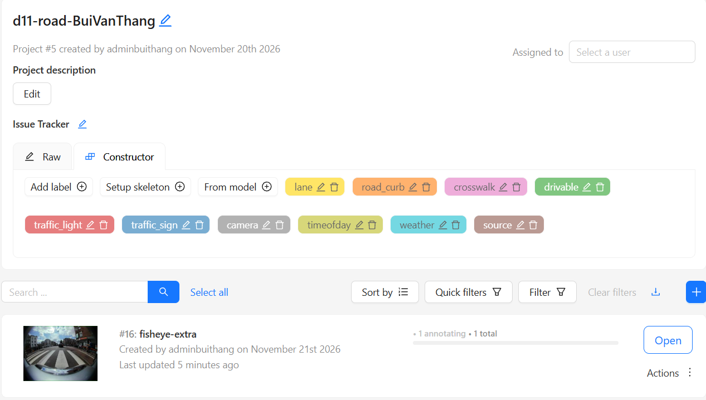

# Báo cáo cá nhân — Ngày 11

Họ tên: Bùi Văn Thắng  
Mã học viên: 2A202603150  
Phiên bản CVAT (Help → About): 2.80.1  
Guideline: Road v1.0  
Bản xuất (`revision` trong manifest): 2, bản sửa sau QC chéo  
Thời điểm export: 10:35 ngày 21/11/2026 (giờ Việt Nam)  
Số lần nộp lại sau Rework: 0

## 1. Kiểm project

| Mục                   | Đúng như guideline Road v1.0? | Ghi chú |
| --------------------- | ----------------------------- | ------- |
| 6 label, đúng kiểu    | Đúng | 2 polyline, 2 polygon, 2 rectangle. |
| Thuộc tính và giá trị | Đúng | Project #5 khớp cấu hình Road v1.0. Đã kiểm kiểu, giá trị mặc định và danh sách giá trị. |
| 4 tag ảnh             | Đúng | `camera`, `timeofday`, `weather`, `source` đều có thuộc tính select `value`. |

Tôi dùng phím **N** để kết thúc polyline theo hướng dẫn của lab. Với tag ảnh, tôi chọn **Tag**, sau đó mở **Objects → Details** để kiểm tra giá trị `value`.

Tôi kiểm tra cả bốn task. Job #13 (`front`), #14 (`front-extra`), #15 (`fisheye`) và #16 (`fisheye-extra`) đều có ảnh đúng nhóm và ở trạng thái `completed`.

## 2. Số lượng đã gán

| Task                            | Ảnh | lane | road_curb | crosswalk | drivable | traffic_light | traffic_sign |
| ------------------------------- | --: | ---: | --------: | --------: | -------: | ------------: | -----------: |
| front                           |  12 |   17 |         1 |         3 |        6 |            18 |           15 |
| front-extra (đã kiểm 4 / 4)    |   4 |   11 |         0 |         1 |        2 |            13 |            0 |
| fisheye                         |   8 |    5 |         2 |         4 |        3 |             5 |            2 |
| fisheye-extra (đã kiểm 4 / 4)  |   4 |    0 |         0 |         3 |        1 |             1 |            1 |

Lô của tôi có 114 hình và 112 tag. Cả 28 ảnh đều có đủ 4 tag. Riêng B11, tôi chỉ giữ bốn tag vì các vạch nhìn thấy thuộc ô đỗ xe.

## 3. Bảng ca khó

| Ảnh | Nhãn | Phân vân giữa | Đã chọn | Lý do |
| --- | ---- | ------------- | ------- | ----- |
| A03 | `lane` R1 | Dừng ở xe phía xa hay nối qua đoạn che | Nối đoạn ngắn, bật `occluded` | Phần vạch nhìn thấy cùng hướng trước và sau đoạn che. |
| A05 | `lane` L1/R1 | Quanh xe đỗ có vạch sơn hay chỉ có ranh mặt đường | Gán vùng lái và mép lề | Không thấy cặp vạch sơn xác định làn. |
| A06 | `lane` L1/R1 | Vạch ngang là vạch làn hay vạch qua đường | Gán vùng vạch qua đường | Vạch ngang ngay trước xe thuộc phần đường dành cho người đi bộ. |
| A07–A10 | `lane` L1/R1 | Có cần gán làn ngoài nhóm trọng tâm của từng ảnh | Dùng nhóm đèn cho A07–A08 và nhóm biển cho A09–A10 | Suy ra từ bảng chọn ảnh trong repo. Cần đối chiếu slide Task 1 hoặc xác nhận với coach. |
| A09, A10 và B02 | `traffic_sign` | Một số tấm mờ hoặc nhìn xiên | Chọn nhóm theo chức năng nhìn thấy, dùng `other` nếu khó phân loại | Cần rà lại các nhóm biển đọc không rõ trong QC chéo. |
| B03 | `lane` L1 xa | Vạch trái của làn đang đi hay mép nhánh rẽ | Giữ nguyên trong bản sửa | Người kiểm nghiêng về L1 nhưng còn chờ lead xác nhận. |
| A13 | `lane` và `drivable` | Giọt mưa và mặt đường ướt làm mờ biên | Vẽ tâm các đoạn vạch nhìn được, dùng mép phần đường để ước lượng biên vùng lái | Dừng polyline tại nơi không còn xác định được tâm vạch. |
| B09 | `lane`, `traffic_light`, `traffic_sign` | Vạch trắng trong ảnh thuộc vùng qua đường. Một số vật thể trên cột khó phân biệt | Gán đèn và biển theo nhóm trọng tâm. Biển mờ dùng `other` | Không thấy vạch dọc để gán `lane`. Cần rà lại biển mờ khi kiểm tay. |
| B11 | `lane` | Vạch biên ô đỗ và vạch dọc phân làn | Chỉ giữ bốn tag | Các nét nhìn thấy thuộc ô đỗ xe và vùng kẻ chéo bên cạnh. |

`road_check lint` trên hai file xuất từ CVAT báo 12 cảnh báo QC1-02 ở A05–A10. Các trường hợp trên chưa được coach xác nhận. Cả 8 ảnh thưởng đều không phát sinh cảnh báo lint.

## 4. Phiếu QC 1 nhận được

Phạm Văn Hùng kiểm 6 ảnh trong lô của tôi và kết luận **Hold**. Phiếu ghi 2 lỗi chính trên 52 nhãn (3,8%), 0 lỗi nặng đã xác nhận và 0 lỗi nhẹ. Ca chờ lead là đoạn L1 ở xa trong ảnh B03.

Tôi đồng ý với hai lỗi Hùng ghi và đã sửa như sau.

| Mã lỗi | Số lỗi | Đồng ý? | Đã sửa? |
| --- | ---: | --- | --- |
| QC1-04 | 1 | Có | Đã nối đoạn gần xe của vạch vàng R2 ở A01, bắt đầu tại khoảng (1279, 703) và giữ chiều gần ra xa. |
| QC1-08 | 1 | Có | Đã thêm box đèn đỏ ở mép trái B02, từ (43, 362) đến (61, 394), với `type=vehicle`, `facing=front`, `edge_zone=true`. |

Tôi giữ hai ZIP đã gửi Hùng trong `out/r1/` và xuất bản sửa với `revision=2`. Lô vẫn ở trạng thái **Hold**. Tôi giữ nguyên đoạn L1 xa ở B03 để lead đối chiếu đúng phần Hùng đã đánh dấu.

## 5. Kiểm file export

| File | Mở lại được? | Số shape ảnh 1 (job / file) | Số shape ảnh 2 (job / file) | Tag camera có trong XML? |
| ---- | ------------ | --------------------------- | --------------------------- | ------------------------ |
| `buivanthang-front.zip` (bản sửa sau QC chéo) | Có | A01: 4 / 4 | A02: 3 / 3 | Có, đủ 16 ảnh |
| `buivanthang-fisheye.zip` (bản sửa sau QC chéo) | Có | B01: 1 / 1 | B02: 7 / 7 | Có, đủ 12 ảnh |

Tôi đã mở lại hai ZIP xuất theo CVAT for images 1.1. Mỗi ZIP chỉ chứa `annotations.xml` và manifest ghi `contains_images=false` cho cả hai file.

## 6. Ảnh chụp màn hình

1. Tab Labels của project.
   
2. Ảnh A12 trên CVAT. Ảnh có vạch làn, vùng lái, vạch qua đường, đèn và biển.
   
3. Ảnh B03 trên CVAT. Tôi phóng to đoạn R1 để thấy các điểm bám theo cung của vệt sơn.
   
4. Đoạn XML của vạch vàng R2 ở A01 sau khi sửa, trích từ `buivanthang-front.zip`.

   ```xml
   <polyline label="lane" source="manual" occluded="0"
     points="1279.00,703.00;1200.00,686.00;1100.00,663.00;1000.00,639.00;900.00,615.00;800.00,589.00;749.66,577.89;573.98,535.46;484.41,515.84;464.59,510.40"
     z_order="0">
     <attribute name="position">R2</attribute>
     <attribute name="style">solid</attribute>
     <attribute name="color">yellow</attribute>
     <attribute name="kind">single</attribute>
   </polyline>
   ```

## 7. Tự đánh giá

Phiếu của Hùng ghi một lỗi QC1-04 và một lỗi QC1-08. Tôi chú ý nhất lỗi QC1-04 vì vạch vàng R2 ở A01 còn thấy rõ gần xe nhưng polyline lại bắt đầu giữa ảnh. Ở Ngày 20, tôi sẽ kiểm tra điểm đầu và điểm cuối của từng vạch trước khi chuyển ảnh. Với đèn và biển ở fisheye, tôi sẽ rà cả sát mép vòng ảnh để tránh bỏ sót như B02.

Trong bài toán row-anchor, polyline được nội suy để tạo tọa độ `x` đích ở từng hàng `y`. Khi R2 ở A01 bị thiếu phần gần xe, những hàng giao với đoạn vạch đó có thể bị ghi thành “không có làn”. Nếu mẫu này đi vào huấn luyện, mô hình có thể học bỏ qua vạch vàng ở vùng gần xe dù ảnh vẫn có vạch sơn.

## 8. Từ polyline đến đích row-anchor (tùy chọn)

Tôi dùng `rowanchor` để so sánh vạch R1 ở A01 trong bản sửa của tôi và bản của Hùng. Các giá trị `x` dưới đây tính bằng pixel.

| Bản nhãn | y=720 | y=680 | y=640 | y=600 | y=560 |
| --- | ---: | ---: | ---: | ---: | ---: |
| Bùi Văn Thắng | Không có làn | Không có làn | 598,0 | 538,7 | 485,8 |
| Phạm Văn Hùng | Không có làn | 661,1 | 600,0 | 541,2 | 484,7 |

1. Đầu xa của R1 trong bản tôi là y=519. Nếu rút ngắn 40 px theo trục dọc từ đầu xa, điểm dừng mới là y=559. Hàng y=560 vẫn có làn, nên không có hàng nào trong bảng đổi trạng thái trong trường hợp này.
2. Ở y=720, cả hai polyline đều không cắt hàng nên không tính được độ lệch `x`. Ở y=560, hai bản lệch khoảng 1,1 px. Nếu cùng có sai lệch, hàng gần xe thường ảnh hưởng nhiều hơn đến chức năng giữ làn.
3. Nếu đảo thứ tự điểm, giao điểm của cùng một đoạn vạch với hàng `y` vẫn giữ nguyên. `rowanchor` vẫn nội suy được và cảnh báo chiều vẽ. `road_check lint` cũng có thể báo QC1-04 nếu vạch front đi từ xa về gần.
